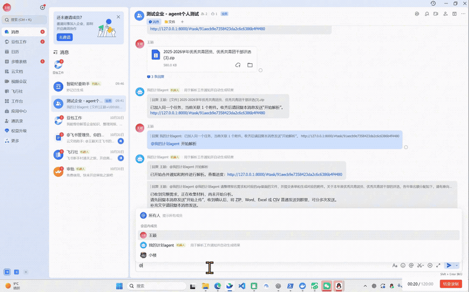
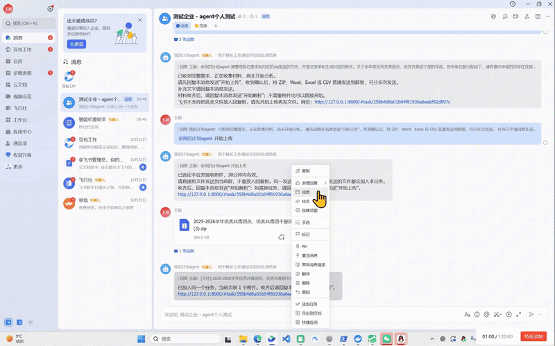
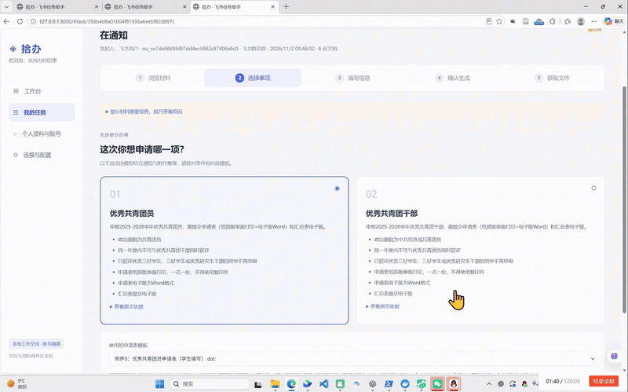
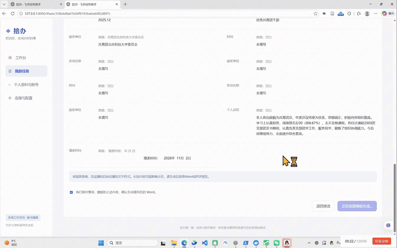

# 《AI课代表帮我“啃文档”》

作为学生的你，有没有遇到过这样的情况：

正值评优评奖季，班群消息一条接着一条。点开通知，申报条件、材料要求、提交时间，密密麻麻铺满屏幕，还没开始填表，就已经看得“头大”。

好不容易理清了文字，下面还有一大堆附件：申请表、汇总表、填写说明……名字看着差不多，只能挨个打开，找出自己需要的那一份。

终于找到表格，准备填写，又发现还要计算成绩排名百分比。填完内容，还得调整格式、修改文件名，再检查有没有漏填。

明明只是申请一次评优，却像做了一套“**阅读理解＋数学计算＋文档排版**”的综合试卷。

于是，我用 Codex 写了一个 AI“课代表”，帮我“啃文档”。

## 01｜通知太长？转给课代表
我想做的，是让它接住收到通知后那些琐碎又重复的操作。

使用时，把通知和附件在线转发给飞书机器人，机器人就会创建任务、接收附件，再交给 AI 解析。

原本散落在长消息和多个文件里的信息，由“课代表”整理成可以操作的任务入口。收到通知后，不必马上埋头翻文件，先把材料交给它。

## 02｜附件太多？先找到跟我有关的
一份通知里，往往包含多个申报项目，对应的表格也各不相同。最让人纠结的就是：“这个我要填吗？那个是不是也得交？”

“课代表”会解析通知和附件之间的关系，将这次评优的申报选项与对应附件整理出来，让我按自己的情况选择。

冗长的任务描述被拆开，当前选项不需要的附件也不必堆在眼前。

对我来说，入口从“一段长通知＋一堆文件”，变成了一个明确的问题：这次，你要申请哪一项？

## 03｜表格难填？换成在线问答
选好项目后，“课代表”会通过在线表单收集信息。

姓名、班级、成绩、排名……原本需要在文档里逐格寻找的填写位置，变成表单中可以依次回答的问题。

我只需要准备好自己的信息，跟着表单填写，就能减少来回切换通知与附件的次数。

遇到排名百分比这类需要计算的内容，系统也会根据输入的数据自动计算，再把结果和其他信息一起回填到附件文档。

当然，输入前仍要看清排名范围和填写口径，避免数据填错，后面的计算也跟着出错。

## 04｜自动填完，还能自己检查和调整
生成文档后，我还可以在线查看内容、调整格式。

哪些文字需要修改，哪些位置需要重新排版，都可以在提交前检查处理。自动填写省下了重复录入的时间，也让我能把精力放在确认信息是否准确、材料是否完整上。

毕竟，“课代表”可以帮忙整理和填写，最后交出去的材料，还是要自己认真看一遍。
## 05｜处理完成，文件直接送回来
确认完成后，文档会自动重命名，再由机器人发送给飞书用户。

从转发通知、选择项目，到填写信息、检查文档，最后拿到文件，整个过程串了起来。

不用先下载一整个 ZIP，再挨个翻找附件；也不用每填一栏，就回聊天记录里重新找一遍要求。

我做这个小工具，是想解决一个很具体的校园烦恼：通知读起来费劲，附件找起来费时，填表还有不少重复劳动。

现在，我给自己找了个随时待命的 AI 课代表。

下次评优通知来了，先不说“怎么又要填表”。

先喊一句：

“课代表，帮我啃一下！” 
